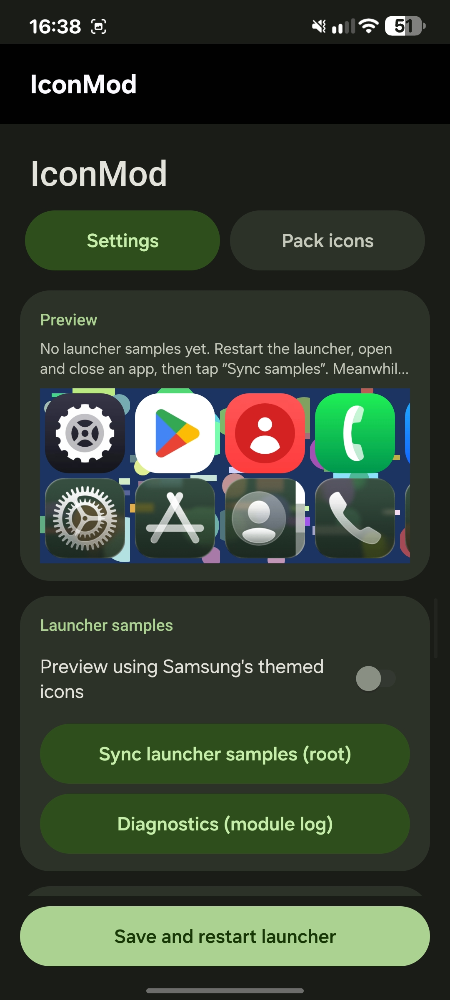
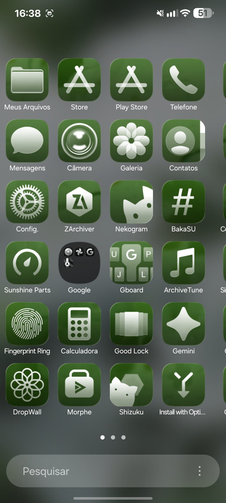
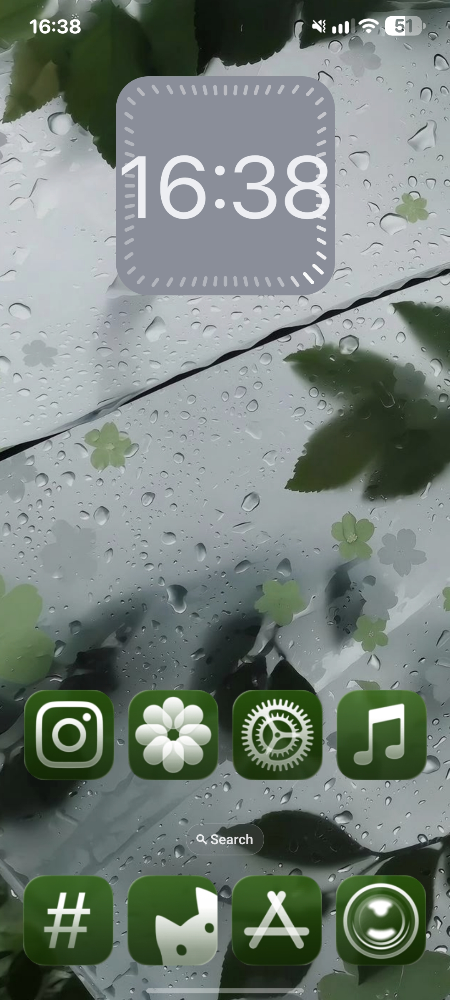

# IconMod

An LSPosed module for customizing icons in **Samsung One UI Home**.

## Screenshots

  
  
  

The icon pack shown in the screenshots is **[iLiquid Glass Dark (Paid)](https://play.google.com/store/apps/details?id=com.eatos.iliquid.glassdark&hl=pt_BR)**. It is a third-party paid icon pack and is not included with IconMod.

## Download

Get the precompiled APK from the **[GitHub Releases page](https://github.com/ELPEDR/IconMod/releases)**.

## Features

- Icon corner and size adjustments
- Icon rendering and icon-pack support
- Backdrop blur and visual effects
- Tint and related visual customization
- A simple implementation of **Liquid Glass-inspired** visual styling

> **Status:** Experimental / initial public release. Behavior may vary by device, One UI version, launcher build, and installed modules.

## Tested environments

IconMod has been tested in the following environments:

- **One UI 8** — rooted device with an unlocked bootloader.
- **One UI 9** — Samsung Galaxy S23 with temporary root access.

These tests do not guarantee compatibility with every device, firmware build, or One UI version.

## Requirements

- Android 10 (API 29) or newer
- Samsung One UI Home
- LSPosed-compatible framework
- Enable the module for One UI Home (`com.sec.android.app.launcher`)

## Installation

1. Download the APK from [GitHub Releases](https://github.com/ELPEDR/IconMod/releases).
2. Install the APK on your device.
3. Open LSPosed, enable IconMod, and select **One UI Home** (`com.sec.android.app.launcher`) as its scope.
4. Restart One UI Home or reboot the device if needed.

Keep a way to disable the module if the launcher becomes unstable. Use it at your own risk.

## Build from source

1. Clone this repository.
2. Open the project in Android Studio.
3. Allow Gradle to sync.
4. Select **Build > Build Bundle(s) / APK(s) > Build APK(s)**.

The project uses Android Gradle Plugin 8.5.2, Java 17, compile SDK 34, and the Xposed API as a compile-only dependency.

## Bug reports

When reporting an issue, include:

- Device model
- Android version
- One UI version
- LSPosed version
- Relevant logs

Please mention the exact steps that caused the issue whenever possible.

## Disclaimer

IconMod is an unofficial community project. It is not affiliated with or endorsed by Samsung, LSPosed, or the Xposed developers. Launcher updates and interactions with other modules may cause instability or compatibility issues.

The Liquid Glass-inspired styling is a simple visual implementation, not a full recreation of Apple's Liquid Glass design system.